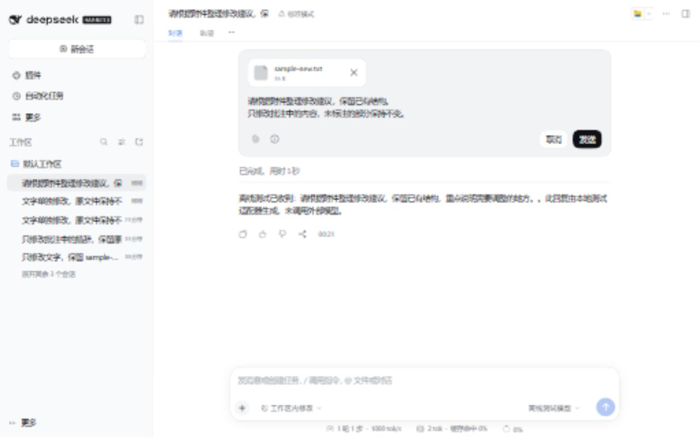

# dsh-inline-edit

The editor's information icon retains DSH's native Tooltip styling and interactions and shows only “Regenerate in this conversation” or “Regenerate in a new branch.” It prefers the lower-right corner with a 6px gap on both axes. Details remain in Settings. Hover, focus and click are supported. The mode is fixed when the editor opens; subsequent setting changes apply to the next edit.

Message edit/copy hints prefer the left side, clearing timestamps and neighboring controls on the same row, with fallback placement when necessary. Clicking an unavailable edit action adds no inline notice; the reason remains available in its tooltip. Crowded layouts choose the least-obstructed position instead of hiding the hint, so zero overlap is not guaranteed. Settings use individually bordered options with a highlighted selection. Submission failures and uncertain outcomes remain visible.

Current version: **0.2.5**. Screenshots illustrate earlier versions. See [Validation](docs/VALIDATION.md) for this release's checks and their limits.

Native inline message editing for DeepSeek Harness. Change text, attachments, or both, with Cancel and Send buttons, native icons and theme tokens.

## Modes

Choose **Settings → Message editing**. Settings persist in the active DSH profile.

- **Create a branch** (default): preserve the source conversation and continue in a new chat.
- **Regenerate in this conversation**: edit only the **latest main message submitted while idle to start a task**. Retain the Session ID and sidebar chat. Later supplemental input and answers are replaced.

Steering and queued input submitted during generation are excluded, even when later processed as a separate turn. The UI hides their edit button and the Host rejects edits. Earlier main messages require branch mode. Wait for generation and the pending queue to finish. DSH's built-in pending-queue editor is unchanged.

[Light settings](assets/settings-light.png) · [Dark settings](assets/settings-dark.png) · [Narrow settings](assets/settings-narrow.png)

## Installation

Tested with **DSH 0.2.1-rc.3 native Web/Host on Windows**, via the desktop installation's CLI. Other releases, Electron-window transport, reverse proxies and real model providers were not independently tested.

~~~sh
dsh plugin --profile desktop add ./dsh-inline-edit-0.2.5.tgz
~~~

Use web instead of desktop for a Web profile. Restart DSH. This package has **not been published** to npm or a marketplace.

~~~sh
dsh plugin --profile desktop remove dsh-inline-edit
~~~

## Behavior

Text-only edits retain attachments. Attachment-only edits can add, remove or replace files. Picking, dropping, pasting, IME, shortcuts and duplicate-send protection are supported. Removing attachments does not delete disk originals. Cancel restores the draft; errors preserve changes.

Current mode uses a logged surface replacement, not rewriting or deleting session files. Old content remains auditable in Trace; usage counters and native turn navigation retain historical turns. Navigation can include superseded content. Disabling the plugin can show old audit content again without restoring the old model context. A short edit-context notice accompanies the replacement.

Regeneration does not undo file changes, commands or external actions.

Repeated edits remove superseded recovery payloads from the active message surface as well. Branching from an edited replacement uses its original boundary. An interrupted edit is not automatically replayed after newer user input. Earlier valid conversation remains; tools can still read historical content from files, Trace or external memory.

Limits: 32 attachments, 64 MiB each, 128 MiB total, 20 MiB images, 200,000 characters. Skills/session references, busy/queued sessions and subagents are refused. Compacted messages require branches. Drafts are memory-only. Other chat-slot replacements may conflict.

## Development

From the source repository (not an unpacked distribution tarball), with Node.js 24.9+:

~~~sh
npm ci
npm run check
npm pack
~~~

Commit prebuilt lib/ and .gitattributes. The latter preserves CRLF in src/style.css so its embedded text-loader output matches the existing bundle on different platforms. DSH provides Host packages and React. No install hooks, private React access, session-file rewriting, telemetry or external model requests are added.

[中文](README.md) · [Validation](docs/VALIDATION.md) · [Architecture](docs/ARCHITECTURE.md) · [Publishing](docs/PUBLISHING.md). MIT; independent of DeepSeek and OpenAI.
